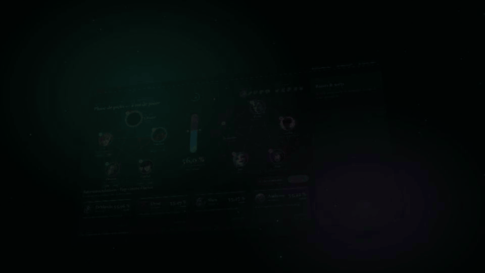
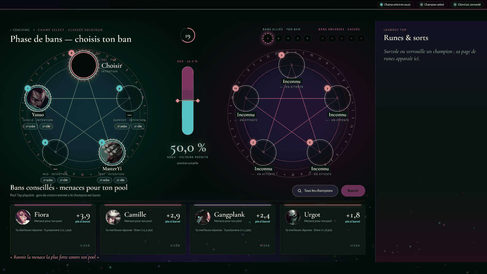
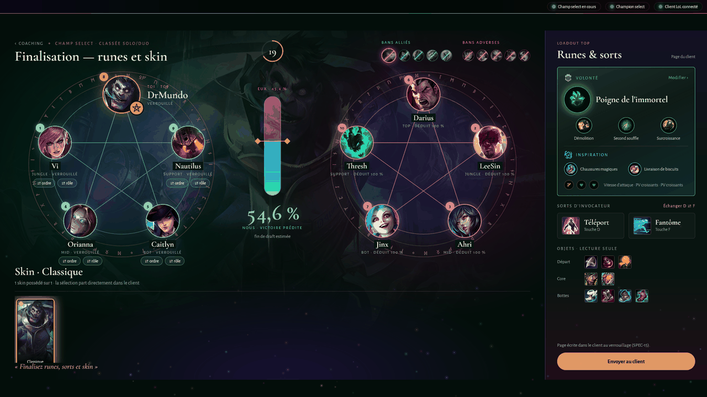
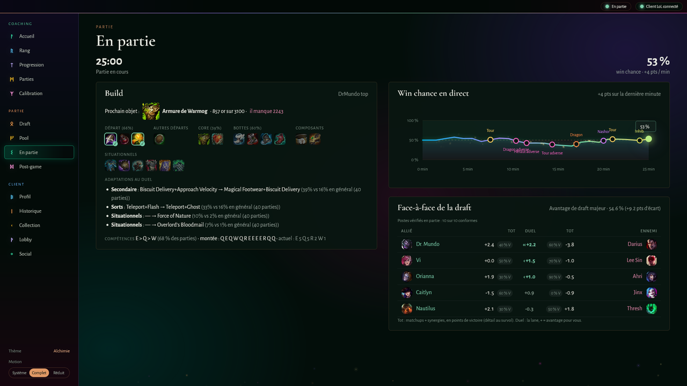
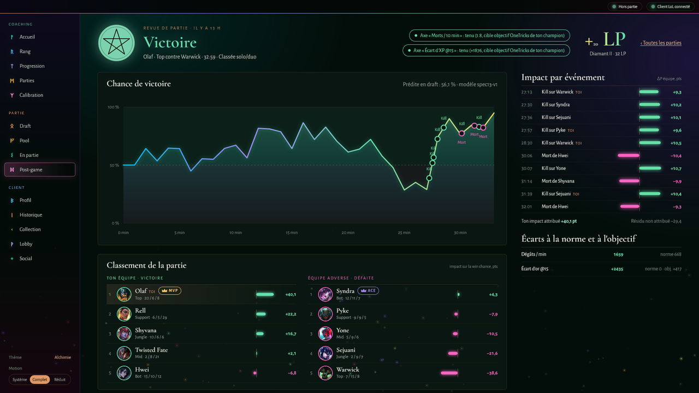
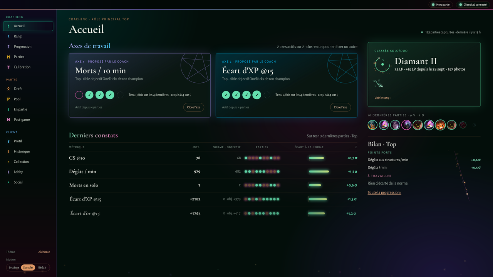
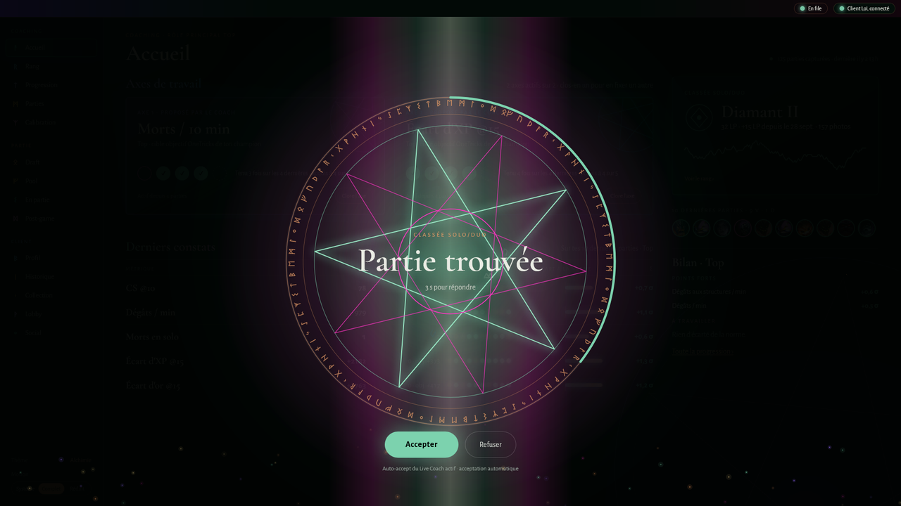
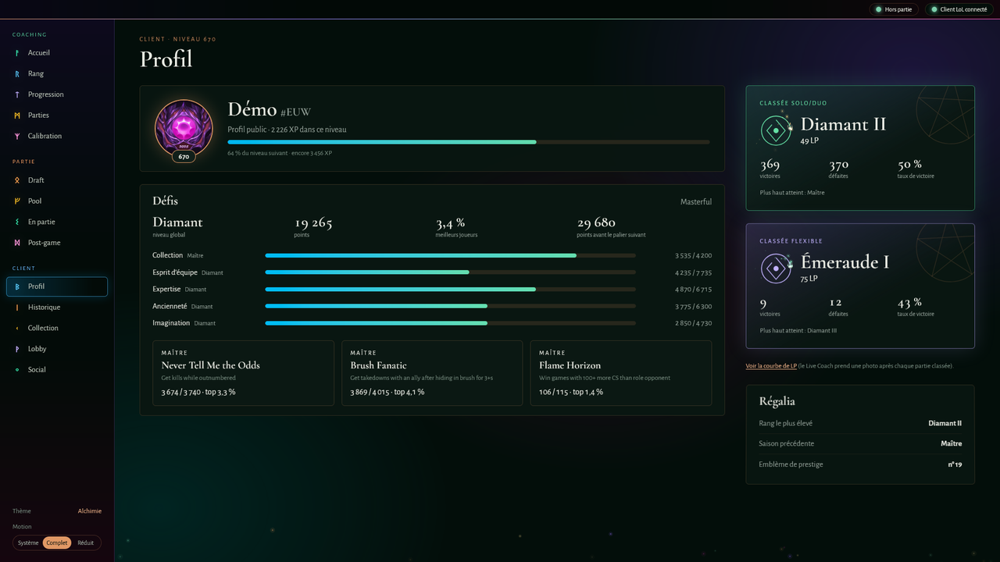

# LeagueStats Coach

[](https://github.com/wApMorty/LeagueStats/actions/workflows/ci.yml)
[](https://www.python.org/downloads/)
[](https://github.com/psf/black)

**Un coach de draft et de partie pour League of Legends.** Il lit ton champion select en direct, te dit
quoi prendre contre qui, importe ta build au verrouillage, suit ta win chance pendant la partie et te
débriefe à la fin.



## Ce que ça fait

### La draft, en direct

Pendant le champion select, le coach lit la draft dans le client LoL et classe les champions de ta pool
selon la victoire prédite face à la composition adverse. Il anticipe aussi les picks qui restent à
jouer, et tient compte de ton niveau sur chaque champion, tiré de tes propres parties : un champion
sur lequel tu performes mal ne passe en tête que si la draft le justifie vraiment. En phase de bans, il chiffre les menaces qui pèsent sur ta pool. Un clic suffit pour survoler ou
verrouiller. Au verrouillage, il écrit dans le client les runes, sorts et objets les plus joués par les
one-tricks de ton champion, affinés contre ton adversaire direct. Tu peux aussi comparer les trois
pages de runes les plus jouées et en choisir une d'un clic.

| Bans | Verrouillage, runes et build |
|---|---|
|  |  |

### La partie, en direct

La win chance se met à jour toutes les quelques secondes, avec les objectifs (tours, dragons, Nashor)
sur la courbe. La build indique le prochain objet à acheter et l'or qu'il manque pour l'avoir. Le face-à-face rappelle
les duels de la draft. Dès l'écran de chargement, une pastille donne la forme récente de chacun des dix
joueurs.



### Après la partie

Chaque partie classée est revue : courbe de win chance, impact de chaque événement, classement des dix
joueurs (MVP et ACE), écarts à ta norme et aux one-tricks Master+. Le coach te propose ensuite des axes
de travail et les suit partie après partie.

| Revue de partie | Accueil du coaching |
|---|---|
|  |  |

### Le client LeagueStats

Une fenêtre native qui parle au client LoL. Elle donne accès au profil, à l'historique, à la collection,
au lobby et à la file, et au social en lecture seule. Une pastille indique en permanence la phase de jeu,
et la partie trouvée s'annonce en grand.

| Partie trouvée | Profil |
|---|---|
|  |  |

## En chiffres

Base du 6 octobre 2026, statistiques LoLalytics au tier Master+ :

- **173** champions ;
- **57 612** matchups : top 15 232, mid 12 825, jungle 11 414, support 10 000, bot 8 141 ;
- builds des one-tricks lues sur OneTricks.gg ;
- images et données de jeu tirées de Data Dragon.

Le décompte vient de `docs/images/captures/manifest.json`, régénéré à chaque passe de captures.

## Essayer sans League of Legends

```bash
python scripts/demo_client.py
```

Le client s'ouvre sur un faux client LoL, avec des pseudos fictifs. Il enchaîne seul le profil, la file,
la partie trouvée, la draft, une partie simulée de 25 minutes, puis la revue, en boucle. Les
recommandations, la build et la win chance sont celles du vrai coach, calculées sur une copie
temporaire de la base. `--scene draft-pick` fige une scène (`--liste` pour toutes les voir). Les
captures de ce README se régénèrent avec `python scripts/capture_screens.py`.

## Démarrage

```bash
pip install -r requirements.txt
python lol_coach.py             # menus
python lol_coach.py --client    # directement le client LeagueStats
```

Menu principal :

1. **Draft Coach en temps réel** : suit le champion select dans la console. Il recommande picks et bans,
   importe la build au verrouillage (désactivable : `draft_config.AUTO_IMPORT_LOADOUT`) et lance le coach
   de gameplay après chaque partie classée (commandes `bilan` et `axe <métrique>`).
2. **Mettre à jour les données** : liste des champions depuis l'API Riot.
3. **Analyser des statistiques** : scrape les matchups (pool SoloQ ou tous les champions).
4. **Analyse & Tournoi** : analyse statistique, coaching manuel de tournoi, bilan du coach de gameplay.
5. **Constructeur d'équipe** : meilleures combinaisons de champions (duos, trios).
6. **Gérer les pools** : pools de champions personnalisées.
7. **Client LeagueStats** : la fenêtre native décrite plus haut.
8. Quitter.

## Mise à jour des données

Les matchups sont scrapés sur LoLalytics avec Selenium et Firefox, en parallèle sur les cinq rôles. Un
scrape complet prend environ **1 h 40** (109 min mesurées le 2026-10-06, 343 pages).

```bash
python scripts/update_all.py
```

C'est l'implémentation de référence : contrôle de complétude, sauvegarde avant réécriture, journal
dans `logs/update_all.log`. Le menu 3 et l'écran **Données** du client (bouton « Actualiser », avancement
lane par lane) s'appuient sur le même pipeline ; un verrou `data/update.lock` empêche deux mises à jour
simultanées. La mise à jour reste manuelle, par choix.

## Distribution

Exécutable Windows portable, sans Python sur le PC cible :

```bash
python build_app.py           # exécutable
python create_package.py      # ZIP de distribution
```

## Structure du projet

```
LeagueStats/
├── lol_coach.py           # point d'entrée
├── build_app.py           # build de l'exécutable
├── create_package.py      # empaquetage
├── scripts/
│   ├── update_all.py      # pipeline de mise à jour des données (référence)
│   ├── demo_client.py     # client en mode démo, sans League of Legends
│   └── capture_screens.py # captures de ce README
├── src/
│   ├── analysis/          # scoring, agrégation, tier lists
│   ├── draft/             # Live Coach : draft, recherche, build
│   ├── coaching/          # coach de gameplay
│   ├── winprob/           # win chance, éclaireur
│   ├── client/            # client LeagueStats (FastAPI + fenêtre native)
│   └── ...
├── data/db.db             # base SQLite (champions, matchups, synergies, coaching)
├── tests/                 # suite pytest
└── docs/                  # specs, ADR, guides, images
```

## Prérequis

- Python 3.13+.
- Firefox, pour le scraping des matchups.
- Le client League of Legends ouvert, pour le Live Coach et le client LeagueStats (API LCU locale).

Pour l'exécutable : Windows 10/11, League of Legends installé, Firefox pour les mises à jour de données.
Aucun Python n'est requis.

La base est un fichier SQLite local (`data/db.db`), dont les migrations passent par Alembic (voir
`docs/alembic_guide.md`).

## Tests

```bash
python -m pytest tests/ -v
```

La CI mesure la couverture sur tout `src/` ; le seuil vit dans `pyproject.toml`.

## Documentation

- `TODO.md` : backlog et sprints.
- `docs/specs/` : spécifications par chantier.
- `docs/adr/` : décisions d'architecture.
- `docs/DATABASE_STRUCTURE.md` : schéma de la base.
- `docs/alembic_guide.md` : migrations.
- `CHANGELOG.md` : historique des versions.

---

LeagueStats Coach n'est ni approuvé ni sponsorisé par Riot Games et ne reflète pas les opinions de Riot
Games ni de quiconque ayant participé à la production ou à la gestion de League of Legends. League of
Legends et Riot Games sont des marques ou des marques déposées de Riot Games, Inc.

**Version** : 5.9.0
